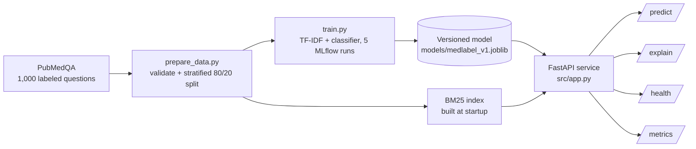
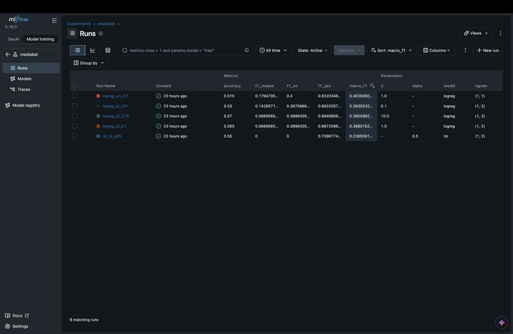

# MedLabel

An end-to-end MLOps pipeline for PubMedQA answer classification. Given a biomedical research question, MedLabel predicts whether the evidence answers it **yes**, **no** or **maybe**, and returns the supporting PubMed passages behind the label.

> MedLabel is a decision-support demo for a course project. It is not a clinical tool and does not give medical advice.

## Architecture



The **train phase** runs once per model version and ends in a saved model file. The **serve phase** loads that file once at startup and answers requests. The model is never retrained at request time.

## Dataset

| Property | Detail |
|---|---|
| Source | PubMedQA, `pqa_labeled` split, loaded with the Hugging Face `datasets` library |
| Size | 1,000 expert-labeled instances |
| Task | 3-class classification (yes, no, maybe) |
| Class balance | About 55% yes, 34% no, 11% maybe |
| Input | Question plus the abstract's context passages |
| Split | Stratified 80/20 train/test (800/200), fixed seed (42) |
| Metric | Macro-F1 (primary), with per-class F1 |

Only a 50-row sample (`data/sample.csv`) is committed. `prepare_data.py` downloads the full dataset and writes `data/train.csv` and `data/test.csv` (ignored by Git). It checks for missing values, empty text and unexpected labels before splitting. Macro-F1 is used because the majority class would otherwise make a weak model look strong.

## Results

Five runs were tracked in MLflow, varying n-gram range, regularization strength and model type:

| Run | Model | N-grams | Regularization | Macro-F1 | Accuracy |
|---|---|---|---|---|---|
| **logreg_uni_C1** | Logistic regression | (1,1) | C=1.0 | **0.403** | 0.515 |
| logreg_bi_C01 | Logistic regression | (1,2) | C=0.1 | 0.394 | 0.530 |
| logreg_bi_C10 | Logistic regression | (1,2) | C=10.0 | 0.391 | 0.570 |
| logreg_bi_C1 | Logistic regression | (1,2) | C=1.0 | 0.388 | 0.565 |
| nb_bi_a05 | Multinomial Naive Bayes | (1,2) | alpha=0.5 | 0.237 | 0.550 |



**Selected model:** `logreg_uni_C1`, the run with the highest macro-F1. Its per-class F1 scores are **yes 0.632, no 0.400, maybe 0.176**.

How to read these numbers honestly:
- The scores are modest, as expected with 800 training examples and TF-IDF features. The goal of this project is the pipeline, not a high score.
- The Naive Bayes run predicts "yes" for nearly everything. Its accuracy of 0.55 matches the share of "yes" labels, so it is effectively a majority-class baseline.
- The four logistic regression runs are within 0.015 macro-F1 of each other. On a 200-question test set, that gap is likely noise, so we do not claim that n-gram range or regularization made a real difference.
- The best run was chosen on the same test set it was scored on (there is no separate validation set), so its score is slightly optimistic.
- The rare "maybe" class is the hardest to learn (F1 0.176).

## Setup and usage

Requires Python 3 (developed on 3.14) and `make`.

```bash
git clone https://github.com/FahadShah7/MedLabel.git
cd MedLabel
make setup                  # creates .venv and installs requirements
source .venv/bin/activate
make test                   # runs the pytest suite
make run                    # starts the API at http://127.0.0.1:8000
```

The trained model (`models/medlabel_v1.joblib`) is committed, so the API runs straight after setup. To rebuild the full dataset and retrain:

```bash
make data    # downloads PubMedQA, validates, writes the train/test split
make train   # trains 5 configurations, logs to MLflow, saves the best model
```

Interactive API docs are generated automatically at `http://127.0.0.1:8000/docs`.

### Configuration

| Variable | Default | Meaning |
|---|---|---|
| `MODEL_PATH` | `models/medlabel_v1.joblib` | Model file loaded at startup |
| `DATA_DIR` | `data` | Folder with the abstracts used for retrieval |

If `data/train.csv` and `data/test.csv` are missing, retrieval falls back to the committed 50-row sample.

## API

| Endpoint | Method | Description |
|---|---|---|
| `/predict` | POST | Returns a label (yes, no or maybe) with a confidence score |
| `/explain` | POST | Returns the top 3 supporting PubMed passages (BM25 retrieval) |
| `/health` | GET | Reports whether the service is up and the model is loaded |
| `/metrics` | GET | Reports request count and average latency |

```bash
curl -X POST http://127.0.0.1:8000/predict \
  -H "Content-Type: application/json" \
  -d '{"question": "Does aspirin reduce the risk of heart attack?"}'

curl -X POST http://127.0.0.1:8000/explain \
  -H "Content-Type: application/json" \
  -d '{"question": "Does smoking cause lung cancer?"}'
```

`/predict` takes a question and an optional `context`. The model was trained on question plus context, so when no context is sent, the service retrieves the top 3 passages with BM25 and uses them. The response field `context_source` says whether the context was `provided` or `retrieved`. Invalid input (a missing or too-short question) returns HTTP 422.

## Project structure

- `src/prepare_data.py`: download, validate and split the data
- `src/train.py`: train, evaluate, track in MLflow, save the best model
- `src/app.py`: FastAPI service
- `tests/`: pytest suite (data validation, model loading, endpoints)
- `models/`: versioned model artifact and its metrics
- `data/sample.csv`: small committed sample of the dataset
- `docs/`: figures used in this README

## Limitations

- Modest accuracy: macro-F1 is 0.40, and the "maybe" class is hard to learn.
- The retrieval pool is the same dataset the model was trained on, so a question taken from PubMedQA will retrieve its own abstract. This affects the demo and does not reflect real-world retrieval quality.
- For a question with no context, the label is predicted from retrieved passages, which may not be the abstract that actually answers it.
- Decision-support demo only. Not for clinical use.

## References

- Jin, Q., Dhingra, B., Liu, Z., Cohen, W., Lu, X. (2019). *PubMedQA: A Dataset for Biomedical Research Question Answering.* EMNLP-IJCNLP 2019.
- The BM25 retrieval idea is reused from the author's earlier project, [MedRAG](https://github.com/FahadShah7/MedRag). No code is copied without attribution.
- Libraries: FastAPI, Pydantic, scikit-learn, rank-bm25, MLflow, pandas, Hugging Face `datasets`.
