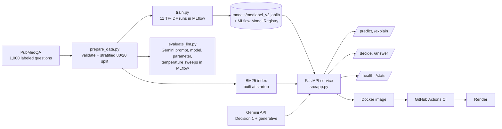
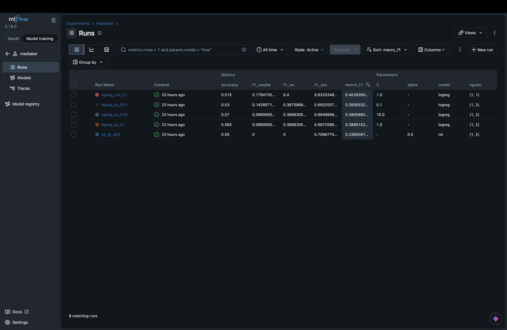

# MedLabel

An end-to-end MLOps pipeline for PubMedQA answer classification. Given a biomedical research question, MedLabel predicts whether the evidence answers it **yes**, **no** or **maybe**, returns the supporting PubMed passages, and compares a classical TF-IDF model with Google's **Gemini Decision 1** and generative Gemini models.

> MedLabel is a decision-support demo for a course project. It is not a clinical tool and does not give medical advice.

**Live API:** `https://medlabel.onrender.com` (interactive docs at [`/docs`](https://medlabel.onrender.com/docs)). It runs on Render's free plan, so the first request after a quiet period takes about a minute. If the link is down, the service was shut down after grading to save cost.

## Architecture



The **train phase** runs once per model version and ends in a saved model file. The **serve phase** loads that file once at startup and answers requests; the model is never retrained at request time. Gemini models are called at request time through the Gemini API.

## Quick start

### Docker (one command)

```bash
git clone https://github.com/FahadShah7/MedLabel.git && cd MedLabel
docker build -t medlabel . && docker run -p 8000:8000 -e GEMINI_API_KEY=<your-key> medlabel
```

Open http://127.0.0.1:8000/docs. `docker ps` shows the container as `(healthy)` once `/health` passes. The `GEMINI_API_KEY` is optional: without it, `/predict`, `/explain`, `/health` and `/stats` work and the two Gemini endpoints return 503. Get a key from [Google AI Studio](https://aistudio.google.com/apikey).

### Local Python (Python 3.11+)

```bash
make setup                  # creates .venv and installs requirements-dev.txt
source .venv/bin/activate
make test                   # runs the pytest suite
make run                    # starts the API at http://127.0.0.1:8000
```

To rebuild everything from scratch:

```bash
make data    # downloads PubMedQA, validates, writes the train/test split
make train   # trains 11 configurations, logs to MLflow, saves and registers the best model
make eval    # evaluates Gemini variations in MLflow (needs GEMINI_API_KEY)
make mlflow  # opens the MLflow UI at http://127.0.0.1:5000
```

On Windows without `make`, run the commands in the `Makefile` directly, for example `.venv\Scripts\python src/train.py` and `.venv\Scripts\python -m src.evaluate_llm`.

## Dataset

| Property | Detail |
|---|---|
| Source | PubMedQA, `pqa_labeled` split, loaded with the Hugging Face `datasets` library |
| Size | 1,000 expert-labeled instances (552 yes, 338 no, 110 maybe) |
| Task | 3-class classification (yes, no, maybe) |
| Input | Question plus the abstract's context passages (about 13 and 200 words on average) |
| Split | Stratified 80/20 train/test (800/200), fixed seed (42) |
| Metric | Macro-F1 (primary), with per-class F1 |

Only a 50-row sample (`data/sample.csv`) is committed. `prepare_data.py` downloads the full dataset and writes `data/train.csv` and `data/test.csv` (ignored by Git). It rejects missing columns, missing values, duplicate `pubid`s, empty text and unexpected labels before splitting. Macro-F1 is used because 55% of answers are "yes", so accuracy would reward a model that always says "yes".

## Classical model results (MLflow experiment `medlabel`)

Eleven runs. The first five are from Milestone 1; the other six each change one thing from the Milestone 1 winner.

| Run | Change from `logreg_uni_C1` | Macro-F1 | Accuracy |
|---|---|---|---|
| **logreg_uni_C1** | (Milestone 1 winner) | **0.403** | 0.515 |
| logreg_uni_C1_5k_features | Vocabulary capped at 5,000 | 0.402 | 0.510 |
| logreg_char_C1 | Character 3-5-grams instead of words | 0.396 | 0.530 |
| logreg_bi_C01 | Bigrams, C=0.1 | 0.394 | 0.530 |
| logreg_bi_C10 | Bigrams, C=10 | 0.391 | 0.570 |
| logreg_bi_C1 | Bigrams | 0.388 | 0.565 |
| logreg_uni_C1_question_only | Question text only, no abstract | 0.381 | 0.475 |
| linear_svm_uni_C1 | Calibrated linear SVM | 0.339 | 0.565 |
| logreg_uni_C1_unbalanced | No class weighting | 0.304 | 0.570 |
| complement_nb_uni_a1 | Complement Naive Bayes | 0.245 | 0.550 |
| nb_bi_a05 | Multinomial Naive Bayes, bigrams | 0.237 | 0.550 |



**Selected model:** `logreg_uni_C1`, saved as `models/medlabel_v2.joblib` and registered in the MLflow Model Registry as `medlabel-classifier` with the alias `champion`. Per-class F1: **yes 0.632, no 0.400, maybe 0.176**. Each run also logs its confusion matrix, classification report, the train/test datasets and the fitted model.

How to read these numbers honestly:
- Removing class weighting drops macro-F1 from 0.403 to 0.304 while accuracy rises: the model stops predicting "maybe". This is the clearest evidence for using balanced class weights and macro-F1.
- Dropping the abstract costs only 0.02 macro-F1, so TF-IDF gets most of its signal from the question wording rather than the evidence.
- The top six runs are within 0.02 of each other. On a 200-question test set that gap is likely noise.
- Naive Bayes predicts "yes" for nearly everything (accuracy 0.55 equals the share of "yes"), so it is effectively a majority-class baseline.
- The best run was chosen on the same test set it was scored on, so its score is slightly optimistic.

## LLM evaluation (MLflow experiment `medlabel-llm-eval`)

For the Gemini models there is no training, so we evaluate **inference**. `src/evaluate_llm.py` scores a stratified, fixed sample of the test set (50 questions by default) and changes one thing at a time from a fixed baseline, so each sweep isolates one effect:

| Sweep | What changes | Runs |
|---|---|---|
| `prompts` | Prompt phrasing: `plain` (bare question), `criteria` (adds definitions of yes, no and maybe), `expert` (system instruction as an expert reviewer). Run for both Gemini Decision 1 and generative Gemini | 6 |
| `models` | TF-IDF baseline vs `gemini-decision-1` vs `gemini-3.5-flash-lite` vs `gemini-3.1-flash-lite` | 4 |
| `temperature` | Generative temperature 0.0, 0.5, 1.0, 1.5, 2.0, each run twice to measure label stability | 5 |
| `context` | No abstract, BM25-retrieved abstracts (excluding the question's own), the gold abstract. For all three model types | 9 |
| `parameters` | `top_p` 0.3 vs 0.95 at temperature 1.0; number of retrieved passages k = 1, 3, 5 | 5 |

Every run logs its parameters, metrics (macro-F1, accuracy, per-class F1, invalid-output rate, "maybe" rate, mean confidence, expected calibration error, average and p95 latency, input and output tokens, label stability, and **LLM-as-a-judge faithfulness** of the generated rationale scored by Gemini Decision 1), plus a predictions table, a confusion matrix, the exact prompt text and example traces. Gemini responses are cached in `.cache/` so reruns are free and reproducible.

Baseline: `gemini-3.5-flash-lite`, prompt `criteria`, temperature 0, top_p 0.95, gold abstract. Gemini Decision 1 scores options instead of generating text, so it has no temperature setting; it appears in the prompt, model, context and k sweeps.

**Results** (50 questions: 28 yes, 17 no, 5 maybe):

| Run | Macro-F1 | Accuracy | Calibration error | "Maybe" rate |
|---|---|---|---|---|
| Gemini Decision 1, `plain` prompt | **0.613** | **0.76** | **0.043** | 0.10 |
| Generative `gemini-3.5-flash-lite`, `criteria` prompt (baseline) | 0.587 | 0.72 | 0.205 | 0.16 |
| Gemini Decision 1, `criteria` prompt | 0.582 | 0.68 | 0.089 | 0.26 |
| Generative, `plain` prompt | 0.549 | 0.76 | 0.178 | 0.06 |
| Gemini Decision 1, `expert` prompt | 0.544 | 0.62 | 0.147 | 0.30 |
| Generative, `expert` prompt | 0.499 | 0.68 | 0.259 | 0.08 |
| TF-IDF + logistic regression (gold abstract) | 0.340 | 0.48 | 0.105 | 0.06 |
| Gemini Decision 1, retrieved context (k = 5) | 0.252 | 0.32 | 0.218 | 0.20 |
| Generative, retrieved context | 0.197 | 0.36 | 0.652 | 0.02 |
| Generative, no context | 0.061 | 0.10 | 0.320 | 1.00 |

- **Gemini Decision 1 is the best model**: highest macro-F1 and by far the best calibrated. Its probabilities match how often it is right, while the generative model's self-reported confidence is overconfident (calibration error about 0.2).
- **Simpler prompts work best for the decision model.** Adding definitions or an expert persona pushes it towards "maybe" and lowers accuracy. For the generative model the `criteria` prompt helps.
- **Evidence matters more than anything else.** With no abstract the generative model answers "maybe" every time. Retrieved abstracts from other questions mislead both Gemini models, and more passages (k = 1 → 5) helps only slightly.
- **Both Gemini models beat the classical baseline** by about 0.25 macro-F1 on the same questions.
- **Rationales are faithful:** LLM-as-a-judge faithfulness is 0.86–0.88 when the model sees an abstract, and 0.41 without one.
- At temperature 0 the generative model still changed its label on 6% of questions between repeats (label stability 0.94).
- Latency figures include waits caused by free-tier rate limits, so they are not comparable between runs. With only 5 "maybe" questions, differences of a few points are not significant.

## API

| Endpoint | Method | Description |
|---|---|---|
| `/predict` | POST | TF-IDF model: label (yes, no or maybe), confidence and class probabilities |
| `/decide` | POST | Gemini Decision 1: label with calibrated probabilities |
| `/answer` | POST | Generative Gemini: label, confidence and a one-sentence rationale, plus the passages used. Optional `model` and `temperature` (0 to 2) |
| `/explain` | POST | Top 3 supporting PubMed passages (BM25 retrieval) |
| `/health` | GET | Service status, model version, corpus size, whether Gemini is configured |
| `/stats` | GET | Request count, error count, average latency, per-endpoint latency, predicted label counts |
| `/metrics` | GET | Request count and average latency (kept from Milestone 1) |

All `POST` endpoints take a `question` (5 to 1,000 characters) and an optional `context`. When no context is sent, the service retrieves the top 3 passages with BM25 and uses them; `context_source` says whether the context was `provided` or `retrieved`. Invalid input returns HTTP 422.

### Example requests against the deployed service

```bash
URL=https://medlabel.onrender.com

curl $URL/health

curl -X POST $URL/predict -H "Content-Type: application/json" \
  -d '{"question": "Does aspirin reduce the risk of heart attack?"}'

curl -X POST $URL/decide -H "Content-Type: application/json" \
  -d '{"question": "Is there a link between vitamin D levels and depression in older adults?"}'

curl -X POST $URL/answer -H "Content-Type: application/json" \
  -d '{"question": "Does smoking cause lung cancer?", "temperature": 0.7}'

curl -X POST $URL/explain -H "Content-Type: application/json" \
  -d '{"question": "Does smoking cause lung cancer?"}'

curl $URL/stats
```

## Monitoring

- `GET /stats` shows request count, error count, average latency overall and per endpoint, uptime, and how many of each label have been predicted.
- Every request is logged as one JSON line (`method`, `path`, `status`, `latency_ms`), visible with `docker logs` or in the Render Logs tab.
- Every response carries an `X-Response-Time-Ms` header.
- The Docker `HEALTHCHECK` and Render's health check both call `/health`.

Counters are in memory and reset when the service restarts.

## CI/CD and deployment

`.github/workflows/ci.yml` runs on every push to `main`, on pull requests, and on version tags:

1. **lint**: `ruff check .`
2. **test**: `pytest -v` (Gemini calls use a fake client, so CI needs no API key)
3. **build**: builds the Docker image, starts it, waits for Docker to report `healthy`, smoke-tests `/health`, `/predict` and `/stats`, then pushes the image to `ghcr.io/fahadshah7/medlabel` tagged with the commit SHA, `latest`, or the release tag.

Deployment is on [Render](https://render.com) using `render.yaml`: a Docker web service on the free plan that auto-deploys `main` and uses `/health` as its health check. `GEMINI_API_KEY` is set as a secret in the Render dashboard. See [RUNBOOK.md](RUNBOOK.md) for redeploying and rolling back to a previous image tag or model version.

### Configuration

| Variable | Default | Meaning |
|---|---|---|
| `MODEL_PATH` | `models/medlabel_v2.joblib` | Model file loaded at startup (`models/medlabel_v1.joblib` is kept for rollback) |
| `DATA_DIR` | `data` | Folder with the abstracts used for retrieval |
| `GEMINI_API_KEY` | not set | Enables `/decide` and `/answer` |
| `MLFLOW_TRACKING_URI` | `sqlite:///mlflow.db` | Where training and evaluation runs are logged |
| `PORT` | `8000` | Port the container listens on |

## Project Focus

**Focus: extensive MLflow experimentation comparing a classical model with Gemini decision and generative models, including LLM-as-a-judge evaluation.**

- **What:** a systematic comparison of three ways to answer the same yes/no/maybe question: TF-IDF with logistic regression, Gemini Decision 1 (a scoring model with calibrated probabilities), and generative Gemini (label plus a written rationale). Every variation is an MLflow run.
- **Why it suits this project:** the task is a closed three-way decision, which is exactly what Gemini Decision 1 is built for, while generative models add an explanation that a clinician-facing tool would need. The course asks LLM projects to test prompts, models, parameters and temperature; our sweeps cover all four, plus the effect of the evidence itself (no abstract vs retrieved vs gold).
- **What is built and compared:** 11 classical training runs with model registry, and 29 LLM inference run configurations comparing accuracy (macro-F1), calibration error, label stability across repeats, latency, token cost and rationale faithfulness judged by an LLM.
- **How it is demonstrated:** the MLflow UI (run comparison charts, per-run confusion matrices, prediction tables, traces), and the live `/predict`, `/decide` and `/answer` endpoints answering the same question side by side.
- **Next steps for the final presentation:** run the sweeps on the full 200-question test set, add a confidence threshold that routes low-confidence answers to "needs human review", and use the faithfulness judge to choose the prompt used by `/answer`.

## Tests

`make test` (or `pytest -v`) runs 31 tests:
- **Data** (`tests/test_prepare_data.py`): validation rules, duplicate `pubid`s, stratified and reproducible split, profiling.
- **API** (`tests/test_api.py`): model loading, `/predict`, `/explain`, input validation (422), `/health`, `/metrics` and `/stats` counting requests and errors.
- **Gemini** (`tests/test_gemini.py`): `/decide` and `/answer` with a fake Gemini client, temperature and model validation, invalid model output (502), missing key (503), prompt variants and the judge.

## Project structure

- `src/prepare_data.py`: download, validate and split the data
- `src/train.py`: train, evaluate, track in MLflow, save and register the best model
- `src/llm.py`: Gemini Decision 1 and generative Gemini clients, prompts and the judge
- `src/evaluate_llm.py`: Gemini evaluation sweeps logged to MLflow
- `src/app.py`: FastAPI service
- `tests/`: pytest suite
- `models/`: versioned model artifacts (`v1`, `v2`) and their metrics
- `data/sample.csv`: small committed sample of the dataset
- `Dockerfile`, `.github/workflows/ci.yml`, `render.yaml`, `RUNBOOK.md`: container, CI, deployment and operations
- `docs/`: figures used in this README

## Limitations

- Modest classical accuracy: macro-F1 is 0.40, and the "maybe" class is hard to learn.
- The LLM sweeps use a 50-question sample by default to stay within API quotas, so small differences between runs are not significant.
- The retrieval pool is the same dataset the model was trained on, so a question taken from PubMedQA retrieves its own abstract in the API. The LLM evaluation excludes the question's own abstract in the `retrieved` setting to avoid this.
- Generative confidence is self-reported by the model and is not calibrated; Gemini Decision 1's probabilities are calibrated by design.
- Decision-support demo only. Not for clinical use.

## References

- Jin, Q., Dhingra, B., Liu, Z., Cohen, W., Lu, X. (2019). *PubMedQA: A Dataset for Biomedical Research Question Answering.* EMNLP-IJCNLP 2019.
- Google, [Gemini Decisions API and Gemini Decision 1](https://aistudio.google.com/docs/decisions-api) (2026).
- The BM25 retrieval idea is reused from the author's earlier project, [MedRAG](https://github.com/FahadShah7/MedRag). No code is copied without attribution.
- Libraries: FastAPI, Pydantic, scikit-learn, rank-bm25, MLflow, pandas, Hugging Face `datasets`, `google-genai`, matplotlib. Container base image `python:3.11-slim`. CI on GitHub Actions; hosting on Render.
